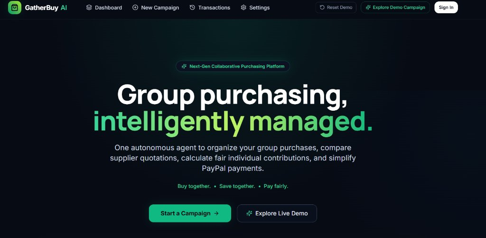

<div align="center">


<h1>GatherBuy AI</h1>

<h3>Group purchasing, intelligently managed.</h3>

<p>One autonomous AI agent to organize your group purchases, compare supplier quotations,<br/>calculate fair individual contributions, and simplify PayPal payments.</p>

<br/>

<a href="https://gatherbuy-ai.vercel.app"></a>&nbsp;
<a href="#-demo-video"></a>&nbsp;
<a href="https://github.com/Shreyanshjain3725/gatherbuy-ai"></a>

<br/><br/>


<br/><br/>

> *Buy together. Save together. Pay fairly.*

</div>

---

## 🎬 Demo Video

<div align="center">

> 📽️ **[▶ Watch the full product walkthrough](#)** — *(Record your demo and drop the YouTube / Loom link here)*

No video yet? Explore the **live app** directly — no signup required.<br/>
Hit **"Explore Live Demo"** on the landing page for an instant guided walkthrough.

</div>

---

## 🌐 Live Application

<div align="center">

| | |
|:---:|:---:|
| **[🚀 Open Live App](https://gatherbuy-ai.vercel.app)** | **[🎮 Try Demo Campaign](https://gatherbuy-ai.vercel.app/join/TECH26)** |
| [📊 Dashboard](https://gatherbuy-ai.vercel.app/dashboard) | [✨ Create New Campaign](https://gatherbuy-ai.vercel.app/campaign/new) |

</div>

---

## 📸 Screenshots

### Landing Page


### Procurement Dashboard


---

## 🧭 How It Works

```
 Natural Language Input
        ↓
 AI Procurement Agent  (Google Gemini)
        ↓
 Structured Purchase Campaign
        ↓
 Supplier Quotation Comparison & Landed Cost Analysis
        ↓
 AI Recommendation & Risk Auditing
        ↓
 FairShare Engine  (Hare-Niemeyer Largest-Remainder)
        ↓
 Member Invitations & Item Selections
        ↓
 PayPal Checkout  (Orders API v2 — Sandbox)
        ↓
 Server-Side Payment Verification & Idempotency
        ↓
 Live Purchase Progress & Audit Trail
```

---

## ✨ Key Features

### 🤖 Conversational AI Procurement Agent
- Converts plain English into structured, Zod-validated JSON campaigns via Google Gemini
- Asks smart clarifying questions — never hallucinates missing data
- Real-time AI advisor you can query anytime:
  - *"Can we cut the budget by 15%?"*
  - *"Which supplier is best?"*
  - *"How much does each person owe?"*
- **AI never controls payment amounts** — all monetary math is deterministic server-side
- Graceful fallback mode when no Gemini API key is configured

### 📊 Smart Supplier Comparison
- Computes true **landed cost**: `Subtotal + Shipping + Tax − Discounts`
- Side-by-side comparison with **Recommended**, **Lowest Cost**, and **Fastest** badges
- MOQ & deadline risk detection — warns before you commit
- Explains tradeoffs in plain language using real computed values

### ⚖️ FairShare Contribution Engine
- **Hare-Niemeyer Largest-Remainder Algorithm** in integer cents — zero rounding drift
- Mathematically guaranteed: every member's share sums exactly to the total
- Proportional freight & tax allocation per member
- Interactive what-if simulator — switch supplier, change quantity, member drops out

### 💳 PayPal Sandbox Integration
- Full **PayPal Orders API v2** — server-side order creation + capture
- Client secret never exposed to the browser
- Payments only confirmed after Sandbox capture verification
- Idempotent transaction handling — no duplicate charges
- Clearly-labelled Demo simulation mode when credentials are absent

### 👥 Participant Invitations & Checkout
- Unique shareable invite link + code (e.g. `TECH26`)
- Interactive item picker with sizes, colors, and quantities
- Live FairShare preview before payment
- Confetti celebration on successful PayPal Sandbox checkout 🎉

### 📄 Export & Audit Trail
- Download procurement reports as **CSV** and **PDF**
- Real-time transaction ledger at `/transactions`

---

## 🛠️ Tech Stack

| Layer | Technologies |
|---|---|
| **Framework** | Next.js 14 — App Router, Server API Routes, TypeScript |
| **Styling & UI** | Tailwind CSS, Lucide Icons, Glassmorphism, Custom Dark Theme |
| **Animation** | Framer Motion, Canvas Confetti |
| **Validation** | Zod |
| **AI** | Google Gemini API (`@google/generative-ai`) |
| **Payments** | PayPal Orders API v2, PayPal Sandbox JS SDK |
| **Database** | Supabase PostgreSQL + In-Memory Demo Store |
| **Charts** | Recharts |
| **PDF Export** | jsPDF + jspdf-autotable |
| **Testing** | Node.js built-in Test Runner |

---

## ⚙️ Getting Started

### 1. Clone
```bash
git clone https://github.com/Shreyanshjain3725/gatherbuy-ai.git
cd gatherbuy-ai
```

### 2. Install
```bash
npm install
```

### 3. Configure `.env.local`
```bash
# Google Gemini AI — https://aistudio.google.com
GEMINI_API_KEY=your-gemini-api-key
GEMINI_MODEL=gemini-1.5-flash

# PayPal Sandbox — https://developer.paypal.com
NEXT_PUBLIC_PAYPAL_CLIENT_ID=your-sandbox-client-id
PAYPAL_CLIENT_SECRET=your-sandbox-client-secret
PAYPAL_BASE_URL=https://api-m.sandbox.paypal.com
PAYPAL_CURRENCY=USD

# Supabase (optional — in-memory demo store is active by default)
NEXT_PUBLIC_SUPABASE_URL=https://your-project.supabase.co
NEXT_PUBLIC_SUPABASE_ANON_KEY=your-anon-key
SUPABASE_SERVICE_ROLE_KEY=your-service-role-key

# App
DEMO_MODE=true
NEXT_PUBLIC_APP_URL=http://localhost:3000
```

> **No API keys?** The app runs fully in Demo Mode with realistic sample data and simulated PayPal payments — zero configuration needed.

### 4. Run tests
```bash
node --test test/business-logic.test.mjs
```

### 5. Dev server
```bash
npm run dev
# → http://localhost:3000
```

### 6. Production build
```bash
npm run build && npm start
```

---

## 🎮 Pre-loaded Demo Campaign

**"TechFest 2026 — Merchandise Procurement"** · Invite Code: `TECH26`

| | |
|---|---|
| **Products** | Heavyweight Hoodies, Poly-Cotton T-shirts, Laser-Etched Badges |
| **Members** | 5 participants (Alex, Samantha, Marcus, Priya, Liam) |
| **Suppliers** | 3 competing quotes (Apex Merch, PrintCraft, Velocity Express) |
| **Status** | \$119.41 collected / \$850.00 total |
| **Join** | [gatherbuy-ai.vercel.app/join/TECH26](https://gatherbuy-ai.vercel.app/join/TECH26) |

> Hit **Reset Demo** in the navbar to restore pristine seed data at any time.

---

## 🔒 Security & Fintech Standards

1. **Deterministic monetary math** — AI never outputs binding amounts; all payment calculations are server-side in integer cents
2. **Credential isolation** — PayPal Client Secret and Supabase Service Role key are strictly server-side
3. **Capture verification** — payments only confirmed after PayPal Sandbox capture response
4. **Idempotency** — duplicate capture requests are safely detected and rejected
5. **No escrow** — GatherBuy AI facilitates direct payments, never acts as an intermediary

---

## 📁 Project Structure

```
src/
├── app/
│   ├── page.tsx                  # Landing page
│   ├── login/                    # Auth & demo entry
│   ├── dashboard/                # Main dashboard
│   ├── campaign/[id]/            # Campaign detail + AI advisor
│   ├── campaign/[id]/suppliers/  # Supplier comparison
│   ├── campaign/new/             # AI campaign creator
│   ├── join/[code]/              # Member invite & checkout
│   ├── transactions/             # Payment audit ledger
│   ├── settings/                 # App settings
│   └── api/                      # Backend API routes
│       ├── ai/                   # Gemini AI endpoints
│       ├── campaigns/            # Campaign CRUD
│       ├── paypal/               # PayPal Orders API v2
│       ├── fairshare/            # Contribution calculator
│       └── demo/                 # Demo reset
├── components/                   # Reusable UI components
└── lib/
    ├── ai/                       # Gemini integration
    ├── db/                       # In-memory store + seed data
    ├── paypal/                   # PayPal SDK wrapper
    └── utils/                    # Business logic (deterministic)
```

---

## 🚀 Deployment

Deployed on **Vercel** — every push to `main` triggers an automatic production deployment.

```bash
npx vercel --prod   # manual deploy
```

**Required environment variables in Vercel:**
`GEMINI_API_KEY` · `NEXT_PUBLIC_PAYPAL_CLIENT_ID` · `PAYPAL_CLIENT_SECRET` · `PAYPAL_BASE_URL` · `PAYPAL_CURRENCY` · `DEMO_MODE`

---

<div align="center">


**GatherBuy AI** — Intelligent Agent for Group Commerce

<a href="https://gatherbuy-ai.vercel.app">gatherbuy-ai.vercel.app</a> · <a href="https://github.com/Shreyanshjain3725/gatherbuy-ai">GitHub</a>

*Buy together. Save together. Pay fairly.*

© 2026 GatherBuy AI Technologies Inc.

</div>
